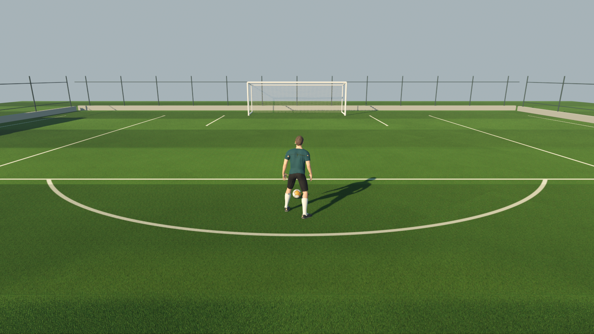

# Son Vuruş — football shooting prototype (Godot 4.7)

An early, unfinished prototype of a small football shooting game: one player, a ball, a goal and
a training pitch. Development is paused; this repository keeps the project in the state it was
left on 9 November 2026. A detailed Turkish development log is in
[docs/DEVLOG.tr.md](docs/DEVLOG.tr.md) and the hand-off notes in [docs/HANDOFF.tr.md](docs/HANDOFF.tr.md).



## What works

- **Player** — MakeHuman (CC0) footballer built by script: athletic build, separate cloth jersey,
  shorts and long socks, boots skinned to the feet.
- **Animation** — idle / walk / jog / sprint from the Quaternius Universal Animation Library
  (CC0), retargeted onto the player through Godot's humanoid profile. Clips are blended by speed
  in m/s against their measured ground speed, with aligned foot-contact phases, to limit foot
  sliding.
- **Controls** — keyboard + mouse and gamepad (FIFA-style: stick jogs, Shift/RT sprints).
  Follow camera with obstruction handling.
- **Ball** — size-5 ball physics (Jolt): air drag, rolling resistance, hollow-shell inertia,
  correct rolling spin; dribble touches only when a boot reaches the ball; ball-only pitch walls.
- **Goal** — post/crossbar collisions; a box rope net (hexagonal mesh, sag, wind, pocket and
  shiver around the ball) that catches shots instead of rebounding.
- **Pitch** — turf texture baked in Blender from ~11 000 modelled blades; mowing stripes come
  from rotating the tile so blades really lie the other way; near-camera shell grass; TAA.

## Not done

- No shot / kick yet (CMU kick mocap was downloaded but not connected), no goalkeeper, no UI,
  no touch controls (a mobile renderer profile exists).
- The generic MakeHuman face and the small print on the jersey texture remain.
- Visual quality was not accepted by the project owner.

## Running

Requires Godot 4.7.1 (Forward+, Vulkan).

```powershell
godot --path game
```

Controls: WASD / left stick move, Shift / RT sprint, mouse / right stick camera,
R / View reset player and ball, Esc release mouse.

## Project layout

| Path | Purpose |
| --- | --- |
| `game/` | Godot project (`world/training_ground.tscn` is the main scene) |
| `game/player/` | Movement, animation blend, dribbling, posture |
| `game/ball/` | Ball physics and look |
| `game/world/` | Pitch, grass, net shaders and scene orchestration |
| `tools/build_training_ground.gd` | Regenerates the scene (run windowed; headless saves MultiMesh data empty) |
| `tools/build_footballer.py` | Builds the player in Blender with MPFB2 (MakeHuman) |
| `tools/bake_turf.py` | Bakes the turf albedo / normal tile in Blender |
| `tools/build_boot.py`, `tools/recipes/` | Parametric boot asset |
| `tools/test_*.gd`, `tools/capture_m01.gd` | External measurement / capture harnesses |
| `evidence/` | Captured engine screenshots and measurement reports |

Downloaded sources (`.source/`) and the isolated Blender profile with MPFB2 (`tools/cache/`) are
not committed; see the hand-off notes for how they were obtained.

## Third-party assets

| Asset | Licence |
| --- | --- |
| MakeHuman system assets (body, skin, eyes, hair, clothes) via MPFB2 | CC0 |
| Quaternius Universal Animation Library (Standard) | CC0 |
| Grab3D Man Base Mesh (retired first player model, still in `game/assets/characters`) | CC0 |
| MPFB2 Blender add-on | GPLv3 — used as a tool only, not included |
| CMU Graphics Lab Motion Capture Database (kick clips, not included) | Free for research and commercial use: "The data used in this project was obtained from mocap.cs.cmu.edu." |

The project's own code and generated assets have no licence chosen yet.
